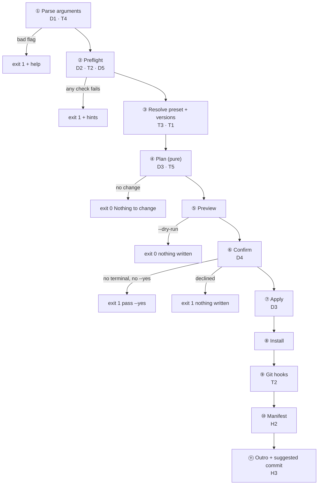

# Workflow: the whole `jss-devtools init` flow

Drawn on 2026-10-21 so that the D and T decision points can be decided against the full flow, not
one stage at a time. The user's words: "D1, D2, D3, D4, D5 chưa quyết. Command init chỉ scaffold dạng
folder structure. Phần D1 - D5 thì phải vẽ ra workflow của toàn flow command init."

Nothing below is decided. A "leaning" is a proposal with its reason.

## Outcome

`init` is one linear pipeline with two exits before any write: a failed preflight, and a dry run or
a declined confirmation. Every stage after "Confirm" changes the repository. The D points sit on four
stages: arguments (D1), preflight (D2), the change model in plan and apply (D3), and confirm (D4).
D5 is about where the shared checks live, not a stage. Sources: JSS's `computePlan`/`applyPlan`
pipeline and the lean-redesign brainstorm
([brainstorm-261019-1038](./brainstorm-261019-1038-jss-devtools-lean-redesign.md)).

## Flow

```text
 jss-devtools init [flags]                                     ◇ = decision point
        │
 ① Parse arguments ◇D1 ◇T4 ──── bad flag ───────────────────▶ exit 1 + help
        │
 ② Preflight (read-only, reports every failure at once) ◇D2 ◇T2 ◇D5
        │  Node floor · git installed · [repo?] · [clean tree?] · [package.json?]
        │  · [monorepo?] · [foreign linter, e.g. biome?]
        ├──── any check fails ──────────────────────────────────▶ exit 1 + hints
        │
 ③ Resolve the preset ◇T3 ── and its versions ◇T1
        │
 ④ Plan (pure, writes nothing) ◇D3 ◇T5
        │  each change → create · update · unchanged   (+ conflict?)
        ├──── no change ────────────────────────────────────────▶ exit 0 "Nothing to change"
        │
 ⑤ Preview   + new file   ~ changed file
        │
        ├──── --dry-run ────────────────────────────────────────▶ exit 0, nothing written
        │
 ⑥ Confirm ◇D4  (skipped by --yes)
        ├──── no terminal and no --yes ─────────────────────────▶ exit 1 + "pass --yes"
        ├──── declined / Ctrl+C ────────────────────────────────▶ exit 1, nothing written
        │
 ⑦ Apply: write files atomically ◇D3                       ┐
 ⑧ Install dependencies (one pnpm install)                  │ change the repo;
 ⑨ Activate git hooks (husky) ── needs a repository ◇T2     │ git is the rollback
 ⑩ Record what was written (manifest, for later updates) ◇H2┘
        │
 ⑪ Outro: next steps, the suggested commit ◇H3 (the CLI does not commit)
        ▼
      exit 0
```



## Decision points on the flow

| # | Stage | Question | Options | Leaning (not decided) |
|---|---|---|---|---|
| D1 | ① | Which flags ship, and when? | (a) the three of the preview: `--framework`, `--yes`, `--dry-run`; (b) plus `--json` (T4); (c) plus the old `--no-install`, `--no-linter`, `--no-commitlint` | (a) now. Add each `--no-*` flag together with the stage it turns off |
| D2 | ② | What must be true before `init` touches the repo? | (a) Node and git only; (b) plus "inside a repository" and "clean tree", so git is the rollback; (c) plus `package.json` present, not a monorepo, no foreign linter | Depends on T2. With overlay only: (c). With scaffolding: (a), and the CLI runs `git init` itself |
| D3 | ④ ⑦ | What kinds of change can a preset ask for? | (a) `write-file` only, where `package.json` is rewritten whole; (b) `write-file` plus `edit-json` for `package.json` (merge scripts and devDependencies); (c) plus a `conflict` status with a per-file choice | (b). `package.json` belongs to the user, so it is merged, never replaced |
| D4 | ⑥ | How is the user asked, and what is an exit? | (a) one confirmation for all changes; no terminal without `--yes` → exit 1; declined → exit 1; (b) declined → exit 0; (c) a prompt per conflicting file | (a). One gate, as in JSS. Exit 1 because nothing the user asked for happened |
| D5 | ② | Where do the checks shared by `doctor` and `init` live? | (a) `core/checks/` and `core/types/` (two new core roles); (b) a copy inside each command; (c) `init` runs `doctor` | (a). A command cannot import another command (decision 0024) |
| T1 | ③ | Versions: an explicit tested table, or the registry? | | Explicit table |
| T2 | ② ⑨ | Overlay an existing repo only, or also scaffold an empty folder? | | Overlay only |
| T3 | ③ | Which presets, in what order? | | None yet |
| T4 | ① | Is the `--json` result a contract? | | None yet |
| T5 | ④ | Which files does `init` generate? | | The toolchain files of this repo, without `src/`, `tests/`, `docs/` and the CLI-specific parts |
| H2, H3 | ⑩ ⑪ | Manifest for updates; does the CLI commit? | | Hash drift plus git; suggest the commit only |

The order to decide them follows the flow: T2 first, because it changes D2 and stage ⑨. Then D3,
because it shapes plan and apply. D1, D4 and D5 are small after that.

## Where the uncommitted code stands

A first cook implemented stages ①, ②, ④, ⑤, ⑥ and ⑦ with the D1 to D5 leanings baked in, and an
empty node preset. That is ahead of the decisions, so it is parked on the branch `wip/init-frame` for
reference and is not on `main`. The user chose "Cất vào branch" and said: "nói chung là trong commit
hiện tại không có code change là được, code đã implement thì cất cũng đc". Once D1 to D5 are
decided against this flow, the init folder structure is planned again from it.

## Unresolved questions

- D1 to D5, T1 to T5, H2 and H3, in the order above. T2 comes first.
